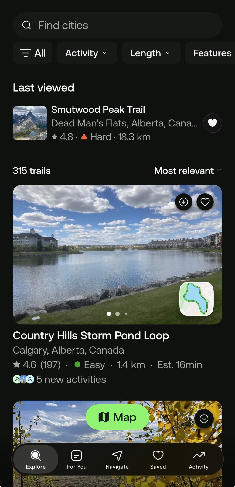
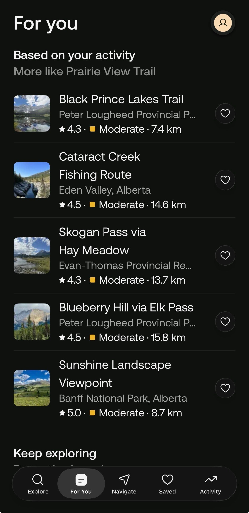
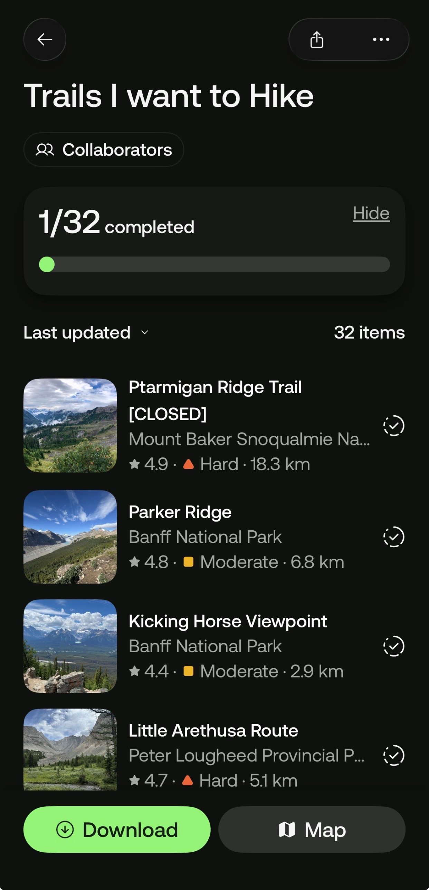
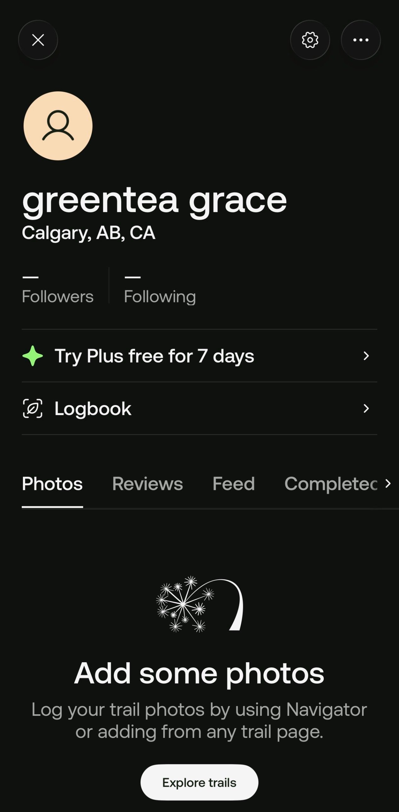
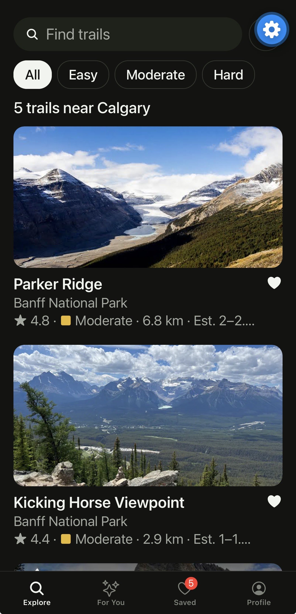
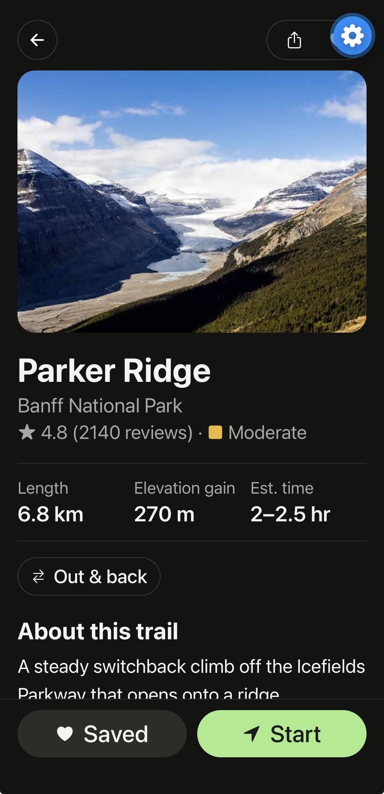
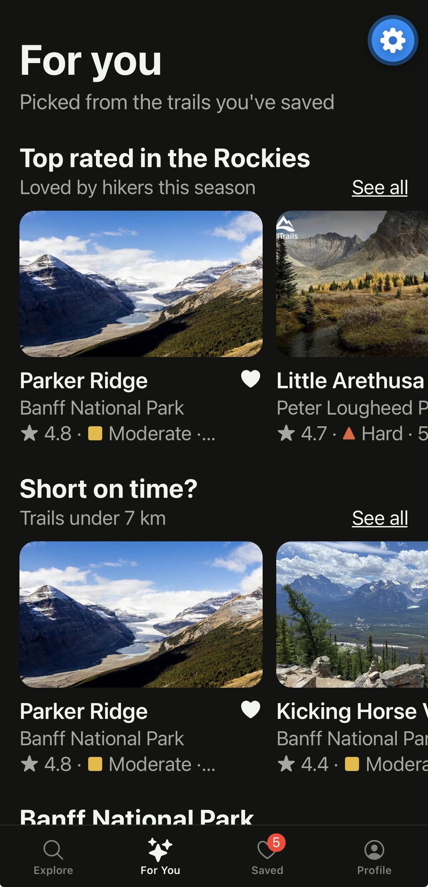
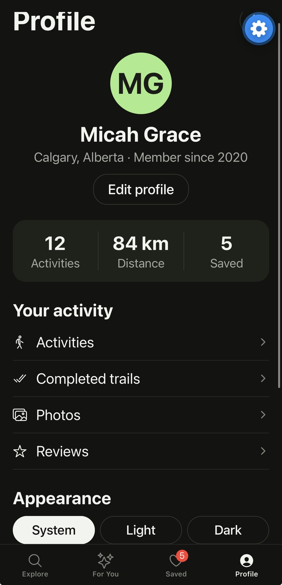
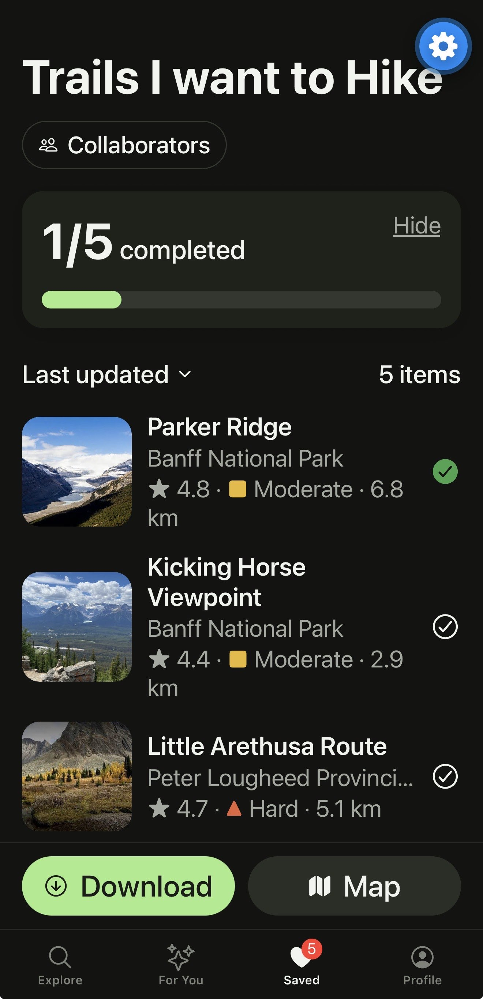

# AllTrails – Multi-Screen Expo App

CPRG 303 Assignment 2: Advanced Multi-Screen Mobile Application with Collaborative Navigation

A copy of the AllTrails app built with Expo, React Native, TypeScript and Expo Router. It has four tabs (Explore, For You, Saved, Profile) and a Trail Detail screen that opens when you tap a trail.

## Features

- **Explore** – search trails by name or park and filter by difficulty
- **For You** – three sideways-scrolling rows of trail suggestions
- **Saved** – the "Trails I want to Hike" list with a progress bar
- **Profile** – mock profile with stats and a light/dark Appearance switch
- **Trail Detail** – opens from any trail card (stack navigation)
- Saving a trail updates the Saved tab, its badge and the Profile stats (shared with Context)
- Light and dark theme

## Original snapshots

## My app

## Run it

npm install
npm start

## Credits

Trail photos are used for educational purposes only. AllTrails is the original app this project copies; this is a student project and is not affiliated with AllTrails.
